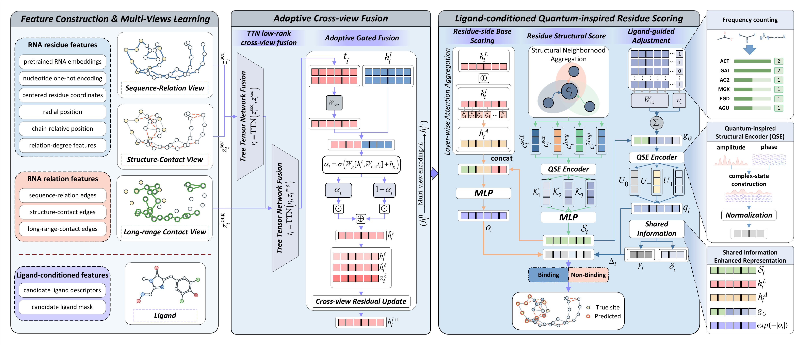

# LQRBind

[English](../README.md) | 简体中文

**用于 RNA 结合位点预测的配体条件化量子启发式多视图学习**

本仓库提供 LQRBind 的官方 PyTorch 实现与可复现性软件包。LQRBind 面向 RNA 相关候选配体集合条件下的结合残基预测，结合多视图 RNA 图编码、低秩树张量网络（TTN）融合和量子启发式结构编码（QSE），为输入 RNA 的每个残基输出一个结合概率。

<p align="center">
  
</p>

<p align="center"><em>LQRBind 概览。模型在三个 RNA 图视图上编码残基和候选配体输入，通过带有自适应门控的低秩 TTN 进行层次化融合，并利用配体条件化 QSE 完成评分。</em></p>

## 方法特点

- **多视图 RNA 表示：** 联合建模序列邻接、二级结构接触和远程接触。
- **层次化跨视图融合：** 使用低秩 TTN 和自适应门控整合互补的 RNA 关系。
- **量子启发式结构编码：** 通过振幅–相位状态和可学习密度态表示残基结构环境。
- **候选配体集合条件预测：** 聚合 RNA 关联候选配体的分子特征，调整残基层结合分数。
- **复现材料：** 提供处理后的基准数据、模型权重、训练配置、候选来源清单和参考预测校验。

## 环境安装

本软件包已在 Python 3.11.11、PyTorch 2.6.0、PyTorch Geometric 2.7.0 和 scikit-learn 1.8.0 环境下完成验证。模型评估支持 CPU 和 CUDA 设备，训练推荐使用 CUDA。

### Conda

```bash
git clone https://github.com/KajiMaCN/LQRBind.git
cd LQRBind
conda env create -f environment.yml
conda activate lqrbind
```

### pip

如果默认安装包与本地 CUDA 驱动不兼容，请先安装与本地 CUDA 驱动匹配的 PyTorch 版本，然后运行：

```bash
python -m venv .venv
source .venv/bin/activate
python -m pip install --upgrade pip
python -m pip install -r requirements.txt
```

## 快速开始

运行以下命令以验证发布文件，并使用默认的 `checkpoints/lqrbind_seed497.pt` 检查点复现推理结果：

```bash
bash scripts/reproduce.sh
```

该命令执行以下两项检查：

1. `scripts/verify_package.py` 验证清单中文件的校验和，以及默认检查点的结构。
2. `scripts/evaluate_lqrbind.py` 重建模型输入，重新生成逐残基预测概率，并使用 `configs/lqrbind_paper_metrics.json` 中各数据集的阈值计算分类指标。

复现指标将写入 `results/reproduced_metrics.csv`。也可以直接运行评估脚本：

```bash
python scripts/evaluate_lqrbind.py --device auto --save-predictions
```

### 模型权重与候选来源

`checkpoints/` 目录提供 seed148、seed184、seed224、seed389 和 seed497 的模型权重。

推理使用的模型配置位于 `configs/lqrbind_paper_checkpoint.json`。

`data/metadata/candidate_sources.csv` 列出测试输入、候选配体组分及其来源记录。候选构建使用的 RNA–配体关联元数据位于 `data/metadata/rna_ligand_metadata.csv`。

### 论文报告结果

下表为论文报告的结果，对应 `configs/lqrbind_paper_metrics.json`。

| 数据集 | Precision | Recall | MCC | AUC |
|---|---:|---:|---:|---:|
| Test18 | 0.662 | 0.454 | 0.375 | 0.771 |
| Apo test | 0.467 | 0.553 | 0.420 | 0.805 |
| Conformational test | 0.746 | 0.552 | 0.413 | 0.759 |

LQRBind 包含 2,541,513 个可训练参数。

## 训练

可以在不启动训练的情况下查看完整训练命令：

```bash
python scripts/train_lqrbind.py --dry-run
```

运行一个 epoch 的流程检查：

```bash
python scripts/train_lqrbind.py --device cuda --smoke-test
```

启动完整训练配置：

```bash
python scripts/train_lqrbind.py --device cuda
```

## 仓库结构

```text
LQRBind/
├── assets/                  # README 图片
├── checkpoints/             # 默认模型与四份补充分析权重
├── configs/                 # 评估与重新训练配置
├── data/                    # 基准数据、配体元数据与候选来源清单
├── docs/                    # 中文 README
├── expected_predictions/    # seed497 的参考标签和预测概率
├── scripts/                 # 评估、训练与验证入口脚本
├── src/                     # 模型、数据、损失、指标与训练代码
├── tests/                   # 检查点兼容性与预测回归测试
├── environment.yml
└── requirements.txt
```

## 引用

本文目前正在审稿中，正式发表后将更新引用信息。

```bibtex
@unpublished{ma2026lqrbind,
  title  = {Ligand-Conditioned Quantum-Inspired Multi-View Learning for RNA Binding Site Prediction},
  author = {Ma, Zhihao and Wang, Hailing and Chen, Yu and Xi, Xidong and Cao, Guitao and Tan, Yaw Sing and Deng, Lei and Wu, Min},
  year   = {2026},
  note   = {Manuscript under review}
}
```

## 问题反馈

如果遇到问题或有任何疑问，请在本仓库中提交 Issue。
